

  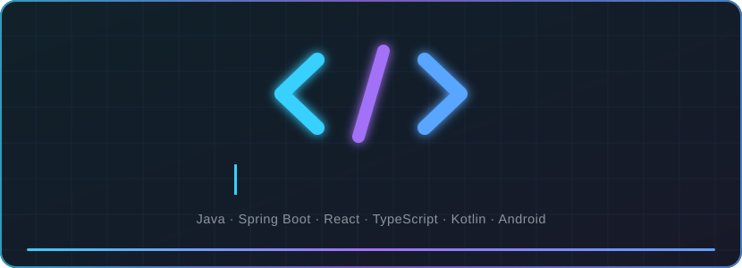

  

  

  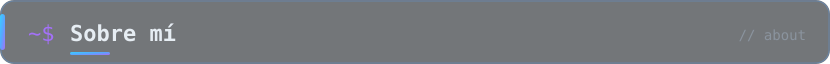

Hola, soy **Jonás Chávez Bolaños** (alias **TechTonic | Dev**), estudiante de **Ingeniería de Sistemas (6.º ciclo)** en la Universidad Peruana Unión, orientado al desarrollo **Full Stack**.

Construyo **APIs REST**, aplicaciones web y **apps Android nativas** con Java, Spring Boot, React, TypeScript y Kotlin. Me gusta trabajar con arquitecturas por capas, integraciones con APIs externas, procesamiento asíncrono en Python y servicios serverless. Sigo fortaleciendo buenas prácticas de arquitectura, testing y desarrollo de software.

📍 Lima, Perú &nbsp;·&nbsp; 🗣️ Español (nativo) · Inglés (intermedio)
🎯 Busco prácticas profesionales y posiciones **junior** en desarrollo de software.

  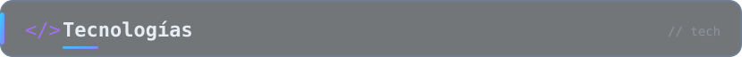

  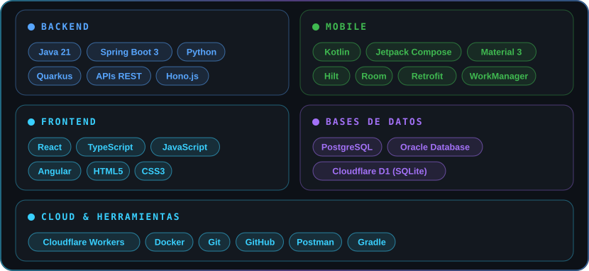

  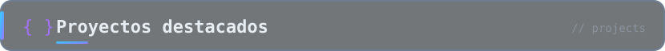

  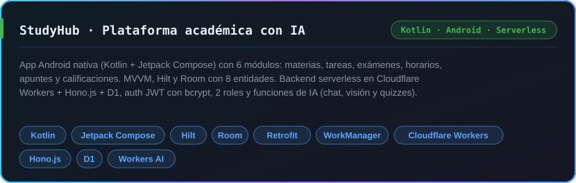

  <a href="https://github.com/Jonas26-hash/Sistema-de-monitoreo-de-pacientes">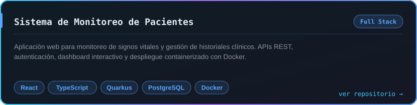</a>

  <a href="https://github.com/Jonas26-hash/JARVIS-AI-Asistente-de-Voz-con-Inteligencia-Artificial-en-Tiempo-Real">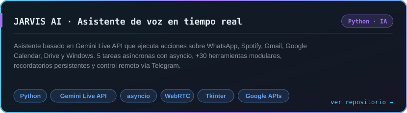</a>

  

  

  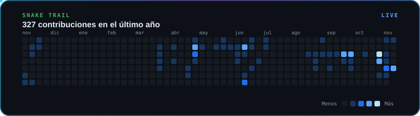

  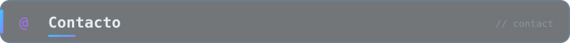

  
  
  

  

